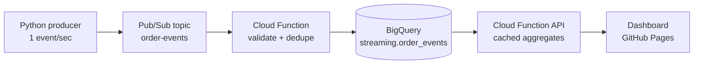

# Real-Time Order Streaming Pipeline

An event-driven data pipeline on Google Cloud. Simulated e-commerce orders are published to Pub/Sub, validated and deduplicated by a Cloud Function, stored in BigQuery, and shown on a live dashboard.

**Live project page:** https://k-nat21.github.io/gcp-streaming-pipeline/


## Architecture



## Tech stack

Python, Pub/Sub, Cloud Functions (2nd gen), Cloud Run, Eventarc, BigQuery, SQL, IAM, Looker Studio, JavaScript.

## Repository layout

```
.
├── index.html              # project page and live dashboard (GitHub Pages)
├── producer.py             # event generator
├── function/               # ingestion Cloud Function (Pub/Sub -> BigQuery)
│   ├── main.py
│   └── requirements.txt
├── dashboard-api/          # HTTP Cloud Function that serves aggregates
│   ├── main.py
│   └── requirements.txt
└── docs/
    └── dashboard.png
```

## Design decisions

- **At-least-once delivery.** Rows are inserted with `order_id` as the insert ID, so duplicate retries are dropped.
- **Bad data does not block the stream.** Invalid events are logged and skipped. A failed insert raises an error so Pub/Sub retries it.
- **Cached API.** The dashboard API runs one aggregate query at most every 20 seconds, which keeps BigQuery usage inside the free tier.
- **Cost guardrails.** Budget alert, capped max instances, and functions deleted when not in use.

## Setup

1. Create a GCP project, link billing, and set a budget alert.
2. Enable the APIs:
   ```bash
   gcloud services enable pubsub.googleapis.com bigquery.googleapis.com \
     cloudfunctions.googleapis.com run.googleapis.com cloudbuild.googleapis.com \
     eventarc.googleapis.com artifactregistry.googleapis.com
   ```
3. Create the topic and table:
   ```bash
   gcloud pubsub topics create order-events
   bq --location=US mk -d streaming
   bq mk --table streaming.order_events \
     order_id:STRING,customer_id:STRING,product:STRING,amount:FLOAT,city:STRING,event_time:TIMESTAMP
   ```
4. Deploy the ingestion function:
   ```bash
   cd function
   gcloud functions deploy process-order-events \
     --gen2 --runtime=python311 --region=us-central1 \
     --source=. --entry-point=handle_event \
     --trigger-topic=order-events --memory=256Mi --max-instances=3
   ```
5. Grant the roles the pipeline needs to the default compute service account (replace `PROJECT` and `SA`):
   ```bash
   for ROLE in roles/cloudbuild.builds.builder roles/bigquery.dataEditor \
               roles/bigquery.jobUser roles/serviceusage.serviceUsageConsumer \
               roles/eventarc.eventReceiver; do
     gcloud projects add-iam-policy-binding PROJECT --member=serviceAccount:SA --role=$ROLE
   done
   gcloud run services add-iam-policy-binding process-order-events \
     --region=us-central1 --member=serviceAccount:SA --role=roles/run.invoker
   ```
6. Deploy the dashboard API:
   ```bash
   cd ../dashboard-api
   gcloud functions deploy order-dashboard-api \
     --gen2 --runtime=python311 --region=us-central1 \
     --source=. --entry-point=api --trigger-http --allow-unauthenticated \
     --memory=256Mi --max-instances=2
   ```
7. Put the API URL in `CONFIG.apiUrl` inside `index.html`, then enable GitHub Pages.
8. Generate traffic: `pip install google-cloud-pubsub && python producer.py`.

## Challenges and lessons

| Problem | Cause | Fix |
|---|---|---|
| Build failed on deploy | Default compute service account lacked the Cloud Build role | `roles/cloudbuild.builds.builder` |
| Eventarc trigger validation error | Missing `serviceusage.services.use` | `roles/serviceusage.serviceUsageConsumer` |
| Messages published, no rows in BigQuery | Push subscription OIDC call rejected by Cloud Run | `roles/run.invoker` on the service |
| Broke again after redeploy | Deleting a function removes its service and IAM binding | Re-grant; manage with Terraform |

## Roadmap

- Medallion layers (Bronze, Silver, Gold) with dbt or Dataform
- Airflow orchestration and data quality checks
- GitHub Actions CI/CD
- Terraform for all infrastructure
